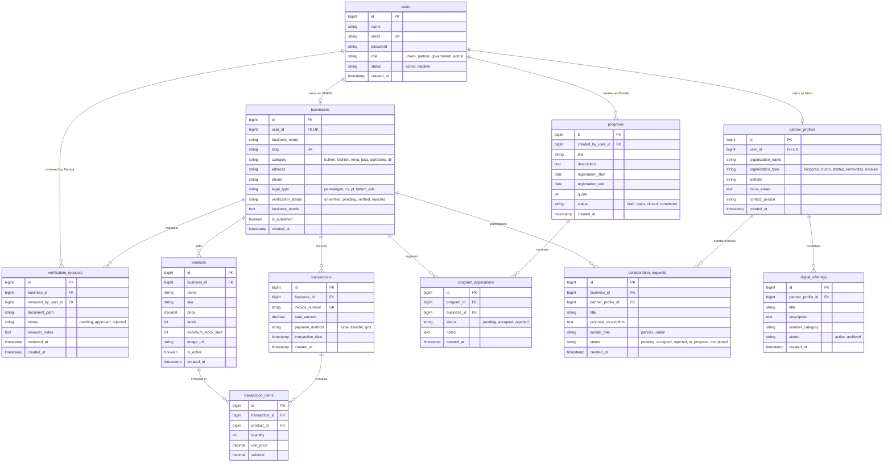

# 🗄️ Baseline Skema Basis Data — KONEKSA Platform

Dokumen ini memuat perancangan struktur tabel basis data relasional MySQL 8 untuk mendukung 21 fitur operasional KONEKSA sesuai proposal pengembangan produk.

---

## 1. Diagram Relasi Entitas (Entity-Relationship Diagram)

---

## 2. Aturan Transaksi & Integritas Basis Data
1. **Pencatatan Transaksi & Penurunan Stok (F06 & F07)**:
   - Wajib dijalankan dalam transaksi atomik (`DB::transaction(...)`).
   - Jika stok barang tidak mencukupi untuk jumlah yang dibeli, rollback transaksi dan kembalikan galat 422.
2. **Pencegahan Over-Quota pada Seleksi Program (F15)**:
   - Saat petugas menyetujui pendaftar program, sistem wajib memeriksa `accepted_count < quota` dengan *row-level locking* (`lockForUpdate()`) agar kuota program tidak pernah terlampaui.
3. **Pemberian Nilai Default & Kolom Nullable**:
   - Seluruh perubahan skema pada tabel eksisting harus mematuhi panduan non-destruktif di `docs/guidelines/FEATURE-DEVELOPMENT-GUIDE.md`.

