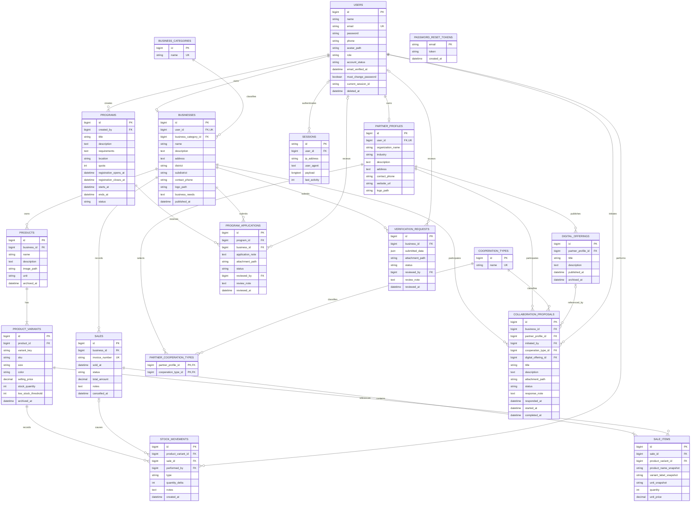

# Rancangan ERD KONEKSA

Ruang lingkup: FR-01–FR-21, Laravel 13, MySQL 8. Berdasarkan proposal dan konfirmasi pemilik rancangan. Ini adalah acuan rancangan data kanonis; sebagian struktur sudah diwujudkan dalam database/migrations/. Periksa migrasi, kode dan test untuk status implementasi aktual. Rancangan ini tidak menyatakan semua invariant sudah ditegakkan aplikasi.

## 1. Keputusan rancangan

Ketentuan terkonfirmasi:

- Satu akun hanya satu peran, tidak dapat berubah peran. Satu akun UMKM memiliki satu usaha; satu akun Mitra memiliki satu organisasi. Profil dapat belum dibuat pada saat registrasi.
- Registrasi UMKM/Mitra harus memverifikasi email sebelum mengakses fitur bisnis. Status administratif akun terpisah dari verifikasi email dan verifikasi usaha.
- Satu admin dibuat developer. Akun pemerintah dibuat admin, dengan password acak yang di-hash dan wajib diganti. Pemerintah tidak membutuhkan profil instansi/jabatan.
- Satu sesi login per akun. Nonaktivasi mencabut seluruh sesi.
- Produk mendukung ukuran/warna; riwayat restock disimpan. Penjualan dapat diedit/dibatalkan.
- Satu usaha dapat mengikuti banyak program; kuota menghitung peserta diterima. Semua petugas pemerintah dapat mengelola seluruh program.
- Pengajuan verifikasi dapat diulang. Catatan keputusan verifikasi disimpan, tanpa tabel audit tindakan admin.

Pilihan desain yang diusulkan, bukan fakta tambahan dari proposal:

- Penghapusan akun memakai soft delete: akses ditutup dan sesi dicabut, sementara data transaksi, proposal, serta keputusan tetap memiliki relasi. Akun baru memakai ID baru dan tidak mewarisi usaha/data akun lama. Ini penghapusan operasional, bukan pemusnahan data pribadi; kebijakan retensi perlu ditetapkan sebelum produksi. Email akun tersimpan tetap unik, termasuk akun terhapus; bila perlu memakai email lama, diperlukan kebijakan pelepasan/anonymisasi email terlebih dahulu.
- Login baru menggantikan sesi perangkat sebelumnya. Tidak memakai fitur remember-me pada MVP agar aturan satu sesi tetap sederhana.
- Satu usaha hanya boleh memiliki satu pendaftaran per program. Banyak program tetap diperbolehkan.
- Semua produk memiliki minimal satu varian. Produk tanpa ukuran/warna memakai varian `default`; stok dan harga berada pada varian, bukan disalin ke produk.
- Ukuran dan warna berupa teks. Belum membutuhkan tabel atribut generik, multi-gudang, diskon, pajak, atau pembayaran.
- Kuantitas stok adalah bilangan bulat. Jika kebutuhan berubah menjadi berat/volume pecahan, evaluasi quantity seluruh tabel terkait secara konsisten dan ubah melalui migrasi baru; jangan mengedit migrasi lama.
- Proposal menghubungkan tepat satu usaha dan satu Mitra; dapat diajukan salah satu pihak. Minat UMKM pada penawaran digital disimpan sebagai proposal yang merujuk penawaran tersebut. Penerima yang memutuskan.
- Pengajuan verifikasi menyimpan snapshot identitas usaha dan lampiran opsional, tanpa mewajibkan NIB. Pemerintah memberikan keputusan administratif, bukan sertifikasi legal.

## 2. Konvensi

- PK domain: BIGINT UNSIGNED auto increment; FK memakai tipe identik.
- Seluruh tabel domain memiliki `created_at` dan `updated_at`, kecuali stock_movements yang cukup memiliki `created_at` karena immutable.
- Uang memakai DECIMAL(15,2), bukan FLOAT. Waktu disimpan konsisten dalam UTC dan ditampilkan WIB.
- `?` pada uraian berarti nullable. Diagram menampilkan atribut inti; aturan lengkap ada pada bagian constraints.
- `||` = tepat satu; `o|` = nol atau satu; `o{` = nol atau banyak.

## 3. Diagram keseluruhan

Password reset memakai email sebagai key bawaan infrastruktur Laravel; tidak digambar sebagai FK domain ke users. SESSIONS adalah tabel infrastruktur; user_id nullable untuk sesi tamu. current_session_id merupakan penanda sesi sah, bukan FK balik yang menciptakan ketergantungan melingkar.

## 4. Detail bagian FR-01–03

### users

| Kolom | Tipe | Ketentuan |
|---|---|---|
| id | BIGINT UNSIGNED | PK |
| name | VARCHAR(150) | Wajib |
| email | VARCHAR(255) | Wajib, unik; normalisasi huruf kecil |
| password | VARCHAR(255) | Hash, tidak pernah plaintext |
| phone | VARCHAR(30) | Nullable; teks agar awalan 0/+ terjaga |
| avatar_path | VARCHAR(255) | Nullable; path storage |
| role | VARCHAR(20) | umkm, partner, government, admin; immutable |
| account_status | VARCHAR(20) | enabled, disabled; default enabled |
| email_verified_at | TIMESTAMP | Nullable sampai email terverifikasi |
| must_change_password | BOOLEAN | Default false; true untuk pemerintah baru |
| current_session_id | VARCHAR(255) | Nullable; jangan diekspos pada respons profil |
| created_at, updated_at | TIMESTAMP | Timestamp Laravel |
| deleted_at | TIMESTAMP | Nullable; soft delete |

Hak akses fitur bisnis mensyaratkan akun enabled, belum terhapus, email terverifikasi, password sementara sudah diganti, dan sesi cocok current_session_id. Akun belum verifikasi masih boleh masuk ke alur terbatas verifikasi email/logout; pemerintah berpassword sementara hanya boleh mengakses alur terbatas yang diperlukan untuk mengganti password dan verifikasi.

Pemerintah juga memverifikasi email. Admin awal diverifikasi melalui proses bootstrap developer yang dipercaya. Pembuatan admin kedua dilarang. Satu admin merupakan invariant aplikasi dan dapat diperkuat MySQL menggunakan generated column nullable yang bernilai 1 hanya untuk role admin dengan UNIQUE index; jangan memakai UNIQUE(role) karena peran lain harus dapat dimiliki banyak akun. Admin awal tidak dapat dihapus/nonaktif melalui UI biasa.

Tidak dibutuhkan roles, permissions, model_has_roles, atau profil pemerintah: empat peran tetap dapat diwakili satu kolom role dan Laravel Policies/Gates. Tambahkan tabel izin hanya bila kebutuhan berubah.

### sessions dan password_reset_tokens

- Gunakan struktur infrastruktur driver sesi database Laravel; index user_id dan last_activity. Sesi tamu diperbolehkan, sehingga UNIQUE(user_id) tidak dipakai.
- Saat login, kunci baris pengguna dalam transaksi, ganti sesi sebelumnya, regenerasi ID sesi dan tetapkan current_session_id baru. Middleware memeriksa penanda tersebut setiap request. Serialisasi login bersamaan dan pengujian request paralel diperlukan; menghapus sesi lama saja tidak cukup.
- Saat nonaktivasi, penghapusan akun, atau reset password, hapus sesi pengguna dan kosongkan current_session_id. Status akun dan penanda sesi tetap diperiksa pada setiap request terautentikasi untuk menolak sesi lama yang mungkin tersimpan kembali oleh request paralel.
- Tautan reset password memakai token yang di-hash, kedaluwarsa, dan sekali pakai. Perubahan password lewat profil membutuhkan password lama. Perubahan email mengosongkan email_verified_at dan mengirim verifikasi ulang.
- Password sementara tidak disimpan pada kolom terpisah atau log; hanya hash pada password. Distribusikan kredensial awal melalui kanal privat.

## 5. Constraints dan integritas lintas fitur

### Profil dan publikasi

- UNIQUE(businesses.user_id), UNIQUE(partner_profiles.user_id).
- Validasi role pemilik: businesses hanya umkm; partner_profiles hanya partner. FK users saja tidak membuktikan kesesuaian role. Terapkan pada service/policy; role tidak bisa diubah.
- Kolom profil opsional: description, contact_phone, logo_path, website_url, business_needs. business_category_id, nama dan alamat wajib ketika profil dipublikasikan. district/subdistrict dapat opsional selama proposal belum mewajibkan detail wilayah. Kota Bandung adalah cakupan tetap, sehingga belum perlu hierarki wilayah nasional.
- published_at nullable = belum publik. Direktori publik mengecualikan akun disabled/terhapus serta usaha yang belum dipublikasikan.
- Nama kategori dan jenis kerja sama dinormalisasi pada tabel referensi. PARTNER_COOPERATION_TYPES memakai PK gabungan; satu Mitra dapat memilih beberapa jenis kerja sama.

### Produk, stok, penjualan

- UNIQUE(product_id, variant_key). variant_key wajib dan kanonis, contoh `default` atau hasil normalisasi pasangan ukuran/warna. Jangan mengandalkan UNIQUE(product_id,size,color) ketika size/color nullable karena MySQL mengizinkan beberapa NULL dalam indeks unik.
- size, color, sku nullable; sku belum diberi UNIQUE global karena bukan ketentuan bisnis. selling_price >= 0; stock_quantity >= 0; low_stock_threshold >= 0.
- STOCK_MOVEMENTS: sale_id nullable untuk stok awal/restock/penyesuaian. quantity_delta bertanda: positif masuk, negatif keluar, tidak boleh nol. type = opening, restock, sale, sale_reversal, adjustment. performed_by wajib; notes wajib untuk adjustment.
- Stok awal juga dicatat sebagai opening. stock_quantity adalah saldo terkini yang dikelola atomik bersama ledger; jangan mengubah saldo langsung tanpa movement.
- SALES.status = recorded atau cancelled. sold_at wajib; notes dan cancelled_at nullable. invoice_number wajib unik. total_amount = jumlah quantity × unit_price dari item; server menghitung ulang, bukan menerima total klien sebagai kebenaran.
- SALE_ITEMS: quantity > 0; unit_price >= 0; UNIQUE(sale_id,product_variant_id). Snapshot menjaga laporan lama saat nama/harga katalog berubah; unit_price adalah harga transaksi, bukan referensi dinamis ke harga katalog.
- Produk item harus berasal dari usaha pemilik transaksi; validasi dalam service karena FK sederhana tidak menjamin kesamaan business_id.
- Edit penjualan: kunci sale dan varian terdampak dalam urutan ID konsisten; buat reversal movement atas item lama, simpan item baru dan movement keluar baru, lalu hitung total dalam satu transaksi. Edit adalah koreksi data berjalan; versi lengkap invoice lama belum disimpan karena audit versi transaksi tidak diminta.
- Pembatalan hanya dari recorded, mengembalikan stok tepat sekali melalui reversal; item dan total transaksi tetap disimpan. Transaksi cancelled tidak dapat diedit. Laporan penjualan hanya menghitung recorded.
- Produk/varian diarsipkan, tidak dihapus bila sudah direferensikan. Arsip tidak menghalangi koreksi transaksi historis yang sah, tetapi melarang penjualan baru.
- Ledger stok tidak diedit/dihapus; koreksi memakai movement baru. FK ke sale tetap stabil walau sale_items direvisi.

### Proposal dan penawaran digital

- Status proposal: pending → rejected atau accepted → ongoing → completed. responded_at wajib setelah keputusan, started_at saat ongoing, completed_at saat completed.
- digital_offering_id, attachment_path, response_note, responded_at, started_at, completed_at nullable sesuai alur. Penawaran boleh memiliki banyak proposal.
- initiated_by harus merupakan user pemilik business atau partner_profile yang bersangkutan. Penerima diturunkan dari pihak lainnya, sehingga tidak perlu kolom penerima duplikat. Hanya penerima boleh menerima/menolak.
- Jika digital_offering_id diisi, offering harus dimiliki Mitra pada proposal tersebut. Proposal minat UMKM memakai offering yang dipublikasikan dan belum diarsipkan. Tawaran Mitra langsung boleh tanpa offering.
- Setelah dikirim, isi proposal tidak dapat diubah agar dasar keputusan stabil. Tidak ada chat dan tabel kemitraan terpisah; satu proposal diterima merupakan satu kerja sama yang dipantau lewat status.
- Kedua pihak boleh mengubah ongoing/completed sesuai policy yang disepakati untuk MVP. Jika kelak perlu persetujuan penyelesaian dua pihak, tambahkan alur konfirmasi, bukan menganggapnya sudah termasuk.

### Program dan pendaftaran

- UNIQUE(program_id,business_id): satu usaha satu pendaftaran per program. Satu usaha tetap bisa mendaftar banyak program.
- PROGRAMS.status = draft, published, closed. Waktu pendaftaran juga diperiksa; published tidak otomatis berarti pendaftaran sedang terbuka.
- quota > 0; registration_opens_at < registration_closes_at; starts_at <= ends_at; registration_closes_at <= starts_at. location dan requirements dapat nullable.
- created_by wajib user government; ini atribusi pembuat, bukan pembatas kepemilikan. Seluruh government boleh mengelola program. Hak membaca data privat tetap dibatasi kebutuhan fitur.
- PROGRAM_APPLICATIONS.status = pending, accepted, rejected. reviewed_by, review_note, reviewed_at nullable sebelum keputusan. application_note dan attachment_path opsional.
- Seleksi menerima peserta dalam transaksi dengan lock baris PROGRAMS, lalu hitung ulang peserta accepted. Semua jalur perubahan keputusan/kuota harus memakai lock program yang sama; quota tidak boleh diturunkan di bawah jumlah accepted.
- Pendaftaran baru hanya saat program published dan dalam rentang waktu pendaftaran. Kuota membatasi penerimaan, bukan otomatis jumlah pelamar.

### Verifikasi usaha

- VERIFICATION_REQUESTS.status = pending, approved, rejected. submitted_data JSON wajib berisi snapshot identitas yang ditinjau, minimal nama usaha, kategori, alamat; snapshot disusun server dari profil, bukan dipercaya dari klien. attachment_path nullable.
- reviewed_by, reviewed_at nullable sebelum keputusan; review_note wajib saat rejected. Reviewer harus government.
- Maksimal satu pending per usaha. Serialisasikan pengajuan dengan lock baris businesses; semua jalur pengajuan mengikuti aturan sama. Bila ingin penegakan tambahan pada DB, gunakan generated nullable business ID untuk pending dengan UNIQUE index; UNIQUE(business_id,status) salah karena menghalangi riwayat penolakan berulang.
- Setelah rejected, pengajuan baru membuat baris baru. Pengajuan/keputusan lama tidak ditimpa. Snapshot dan keputusan bersifat immutable setelah diputuskan.
- Status tampilan diturunkan dari pengajuan terbaru: belum diajukan, pending, approved, rejected. Tidak perlu menyalin verification_status ke users atau businesses.
- Ketika approved, perubahan identitas material (nama, kategori, alamat) diblokir pada MVP. Untuk menggantinya, ajukan snapshot perubahan dalam verifikasi baru dan terapkan ke profil hanya setelah approved; business_needs, kontak dan logo dapat diubah biasa. Dengan ini, identitas publik tidak memakai label verified untuk data material yang belum ditinjau. Selama permohonan perubahan pending, tampilkan identitas lama beserta status pemeriksaan perubahan secara terpisah jika diperlukan UI.

### Penghapusan dan FK

- Default FK historis memakai RESTRICT, bukan cascade massal: users → profil, usaha → transaksi, varian → item/movement, profil → proposal, program → pendaftaran, usaha → verifikasi.
- Akun dihapus operasional lewat soft delete, dengan profil/direktori terkait disembunyikan dan semua sesi dicabut. Riwayat privat hanya dapat dibaca pihak yang berwenang sesuai policy.
- Pivot jenis kerja sama boleh cascade ketika profil benar-benar dibersihkan tanpa riwayat; operasi cleanup tetap terpisah dari hapus akun biasa.
- Tabel sesi/token merupakan data sementara, dibersihkan sesuai masa berlaku. password_reset_tokens.email mengikuti konvensi Laravel dan bukan FK; bersihkan token terkait saat email berubah/akun ditutup.
- Akun baru berbeda identitas kepemilikan. Jangan otomatis memindahkan produk, program, atau proposal hanya karena memakai nama/email serupa.

## 6. Pemetaan FR ke tabel

| FR | Tabel utama |
|---|---|
| 01–03 | users, sessions, password_reset_tokens |
| 04 | businesses, business_categories |
| 05 | products, product_variants |
| 06 | product_variants, stock_movements |
| 07 | sales, sale_items, stock_movements |
| 08–09 | Query agregasi sales/sale_items/varian; tidak perlu tabel dashboard/laporan |
| 10–11 | businesses, business_categories, verification_requests |
| 12 | collaboration_proposals, cooperation_types |
| 13 | programs |
| 14–15 | program_applications, programs |
| 16 | partner_profiles, cooperation_types, partner_cooperation_types |
| 17 | collaboration_proposals |
| 18 | digital_offerings, collaboration_proposals |
| 19–20 | Query agregasi usaha, verifikasi, program, pendaftaran dan proposal |
| 21 | verification_requests |

Total 18 tabel pada rancangan ini, termasuk dua tabel infrastruktur autentikasi. Tabel framework seperti cache, jobs atau failed_jobs ditambahkan hanya bila driver/fitur yang dipakai memerlukannya.

## 7. Urutan migration dan index

1. users; password_reset_tokens; sessions.
2. business_categories; cooperation_types.
3. businesses; partner_profiles; partner_cooperation_types.
4. products; product_variants.
5. sales; sale_items; stock_movements.
6. digital_offerings; collaboration_proposals.
7. programs; program_applications; verification_requests.

Selain index FK/UNIQUE, tambahkan sesuai pola akses: sales(business_id,status,sold_at), stock_movements(product_variant_id,created_at), program_applications(program_id,status), verification_requests(business_id,created_at), collaboration_proposals(business_id,status), collaboration_proposals(partner_profile_id,status), businesses(business_category_id,published_at). Jangan menambah index setiap kolom tanpa kebutuhan query.

Cardinality products → variants dan sales → items minimum satu ditegakkan alur service dalam transaksi; FK saja tidak menjamin induk selalu memiliki anak. Kardinalitas profil 0..1 pada diagram mencerminkan akun yang belum menyelesaikan onboarding; setelah onboarding profil yang sesuai peran wajib tersedia.

## 8. Acuan implementasi resmi

- [Laravel 13 Email Verification](https://laravel.com/framework/docs/13.x/verification): email_verified_at dan verifikasi email bawaan.
- [Laravel 13 Query Builder](https://laravel.com/framework/docs/13.x/queries): pessimistic locking dan lockForUpdate dalam transaksi.
- [Laravel 13 sessions source documentation](https://github.com/laravel/docs/blob/13.x/session.md): struktur sesi database, regenerasi ID dan invalidasi sesi.

Rancangan domain dan kebijakan tambahan di atas merupakan usulan KONEKSA berdasarkan kebutuhan yang dikonfirmasi, bukan klaim bahwa seluruh aturan tersebut ditegakkan otomatis oleh Laravel.
