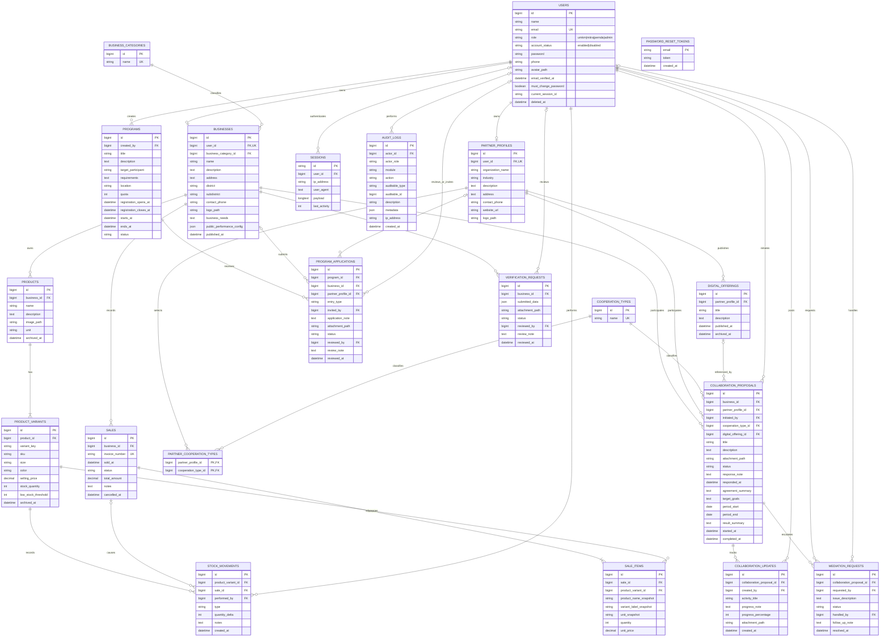

# Rancangan ERD KONEKSA

Ruang lingkup: **FR-01–FR-32 (32 Kelompok Fitur / 64 Functional Requirements)** sesuai Proposal PPL terbaru (revisi 13 November 2026) dan backlog Jira (`KSA`), menggunakan Laravel 13 dan MySQL 8.

Dokumen ini adalah acuan rancangan data kanonis proyek KONEKSA. Sebagian besar struktur dasar (**18 tabel baseline FR-01–FR-21**) sudah diwujudkan dalam `database/migrations/`. Perluasan untuk **FR-22–FR-32** dirancang menggunakan prinsip *minimum additive schema* (migrasi baru tanpa mengubah migrasi lama). Selalu periksa migrasi, kode, dan test untuk memastikan status implementasi aktual.

---

## 1. Keputusan Rancangan & Hasil Audit Arsitektur

### 1.1 Ketentuan Terkonfirmasi (Fakta Proposal & Kontrak Sistem)
- **Empat Role Pengguna Tetap**: Satu akun hanya memiliki satu peran (`role`) yang bersifat *immutable* setelah dibuat. Nilai kanonis di database mengikuti migrasi aktif dan seeder:
  - `'umkm'` — Pelaku UMKM (1 akun mengelola maksimal 1 profil usaha pada `businesses`).
  - `'mitra'` — Mitra Industri (1 akun mengelola maksimal 1 profil organisasi pada `partner_profiles`).
  - `'pemda'` — Petugas Pemerintah Daerah (akun dibuat oleh Superadmin, tidak memerlukan tabel profil terpisah).
  - `'admin'` — Superadmin / Admin Platform (pengelola teknis tertinggi untuk manajemen pengguna, provisioning akun Pemda, tindakan administratif lintas role, dan pengawasan audit trail).
- **Registrasi & Onboarding (`FR-01.1`, `KSA-10`)**:
  - Formulir registrasi publik (`/register`) **hanya** mengizinkan pilihan role `'umkm'` dan `'mitra'`. Pembuatan akun `'pemda'` atau `'admin'` lewat jalur publik dilarang keras.
  - Untuk menjaga isolasi modul antar-anggota tim, registrasi akun dapat langsung membuat entitas `users` terlebih dahulu (kardinalitas `0..1` ke `businesses`/`partner_profiles`), lalu pengguna menyelesaikan pengisian identitas awal usaha/organisasi pada alur onboarding profil (`FR-04.1` / `FR-16.1`), atau dibuat dalam satu transaksi apabila field wajib profil disertakan.
- **Autentikasi, Sesi Tunggal & Status Akun (`FR-01.2`, `FR-03`, `KSA-11`, `KSA-38`)**:
  - Status administratif akun disimpan pada `users.account_status` (`'enabled'` / `'disabled'`), terpisah dari verifikasi email (`email_verified_at`) dan verifikasi administratif usaha (`verification_requests`).
  - Satu sesi login aktif per akun ditegakkan melalui `users.current_session_id`. Login baru menggantikan sesi lama.
  - Nonaktivasi akun (`disabled`), penghapusan akun (*soft delete*), atau reset password wajib mencabut seluruh sesi pengguna di tabel `sessions` dan mengosongkan `current_session_id`.
  - Akun petugas `'pemda'` dibuat oleh `'admin'` dengan `must_change_password = true` dan wajib mengganti password sebelum mengakses fitur operasional.
- **Operasional UMKM (`FR-05`–`FR-09`)**:
  - Produk mendukung varian ukuran/warna (`product_variants`); perubahan stok wajib tercatat secara atomik bersama ledger `stock_movements` (`BR-02`).
  - Produk yang diarsipkan (`archived_at != null`) tidak dapat dipakai pada transaksi baru, tetapi riwayat transaksi tetap utuh (`BR-03`).
- **Direktori, Publikasi Performa & Kolaborasi (`FR-10`–`FR-12`, `FR-16`–`FR-18`, `FR-22`–`FR-25`, `FR-30`)**:
  - Informasi performa UMKM hanya ditampilkan pada profil publik sesuai pengaturan izin publikasi pemilik usaha (`BR-04`).
  - Proposal kolaborasi (`collaboration_proposals`) dapat diinisiasi oleh UMKM maupun Mitra Industri, dan hanya dapat direspons (`accepted`/`rejected`) oleh pihak penerima (`BR-05`).
  - Kemitraan berjalan (`ongoing`) dan selesai (`completed`) dilanjutkan dari proposal yang `accepted` (`BR-06`), mencakup pencatatan ringkasan kesepakatan (`FR-24`), pembaruan progres berkala (`FR-25`), serta laporan hasil kolaborasi (`FR-30`).
- **Program Pemerintah, Seleksi & Undangan VIP (`FR-13`–`FR-15`, `FR-26`–`FR-27`)**:
  - Program/event pemerintah dapat ditujukan kepada UMKM, Mitra Industri, atau keduanya melalui mekanisme pendaftaran umum maupun undangan khusus/VIP (`BR-08`).
  - Satu organisasi tidak boleh memiliki pendaftaran ganda pada kegiatan yang sama (`BR-09`), dan jumlah peserta diterima/terkonfirmasi (termasuk undangan VIP) tidak boleh melebihi kuota (`BR-10`, `BR-11`).
- **Verifikasi Administratif, Mediasi & Monitoring Pemda (`FR-19`–`FR-21`, `FR-28`–`FR-29`)**:
  - Verifikasi UMKM (`verification_requests`) merupakan pemeriksaan administratif oleh petugas `'pemda'` (`BR-12`).
  - Pihak yang terlibat dalam kemitraan dapat mengajukan permintaan fasilitasi/mediasi (`mediation_requests`) yang ditindaklanjuti oleh `'pemda'` (`BR-14`).
- **Superadmin & Audit Trail (`FR-31`–`FR-32`, `BR-15`, `NFR-08`)**:
  - Setiap tindakan administratif penting oleh Superadmin, perubahan status akun, pembuatan akun Pemda, keputusan verifikasi UMKM, keputusan seleksi peserta program, serta perubahan status kemitraan wajib dicatat secara *append-only* pada tabel **`audit_logs`** dengan identitas pelaksana (`actor_id`), waktu, modul, dan jenis aktivitas.

### 1.2 Pilihan Desain Best Practice (Reuse & Anti-Overengineering)
- **Tanpa Tabel RBAC Kompleks**: Tidak menggunakan tabel `roles`, `permissions`, atau `model_has_roles`. Empat role tetap (`umkm`, `mitra`, `pemda`, `admin`) ditegakkan melalui kolom `users.role`, middleware `CheckRole`, dan Laravel Policies/Gates.
- **Soft Delete pada `users`**: Penghapusan akun menggunakan *soft delete* (`deleted_at`) agar FK historis (`RESTRICT`) pada transaksi, pergerakan stok, proposal, verifikasi, dan audit log tidak rusak.
- **Strategi Migrasi Aditif untuk FR-22–FR-32**:
  - **Sudah ada di `database/migrations/` (18 tabel)**: `users`, `password_reset_tokens`, `sessions`, `business_categories`, `cooperation_types`, `businesses`, `partner_profiles`, `partner_cooperation_types`, `products`, `product_variants`, `sales`, `sale_items`, `stock_movements`, `digital_offerings`, `collaboration_proposals`, `programs`, `program_applications`, `verification_requests`.
  - **Migrasi Baru yang Direkomendasikan (3 tabel baru + kolom aditif)**:
    1. Tabel `audit_logs` (`FR-31`, `FR-32` — Sprint 1 `KSA-152`).
    2. Tabel `collaboration_updates` + kolom kesepakatan/hasil pada `collaboration_proposals` (`FR-24`, `FR-25`, `FR-30`).
    3. Tabel `mediation_requests` (`FR-28`).
    4. Kolom aditif visibilitas performa pada `businesses` (`FR-22`) serta dukungan partisipasi Mitra & undangan VIP pada `programs` dan `program_applications` (`FR-14`, `FR-26`, `FR-27`).

---

## 2. Konvensi Skema
- **Primary Key (PK)**: `BIGINT UNSIGNED` auto-increment; Foreign Key (FK) menggunakan tipe identik.
- **Timestamps**: Seluruh tabel domain menggunakan `created_at` dan `updated_at`, kecuali tabel ledger/log yang bersifat *immutable* (`stock_movements` dan `audit_logs`) yang hanya menggunakan `created_at`.
- **Nilai Uang & Waktu**: Uang menggunakan `DECIMAL(15,2)`. Waktu disimpan dalam UTC dan ditampilkan dalam zona waktu aplikasi (`Asia/Jakarta` / WIB).
- **Notasi Kardinalitas**: `||` = tepat satu; `o|` = nol atau satu; `o{` = nol atau banyak; `|{` = satu atau banyak. Tanda `*` pada penjelasan kolom menandakan kolom perluasan aditif untuk FR-22–FR-32.

---

## 3. Diagram Keseluruhan (ERD Kanonis FR-01–FR-32)

---

## 4. Spesifikasi Detail Tabel Inti: Autentikasi, Superadmin & Audit (`FR-01`–`FR-03`, `FR-31`–`FR-32`)

### 4.1 `users` (Sudah Dimigrasikan)

| Kolom | Tipe | Ketentuan & Invariant |
|---|---|---|
| `id` | `BIGINT UNSIGNED` | PK |
| `name` | `VARCHAR(255)` | Wajib |
| `email` | `VARCHAR(255)` | Wajib, unik (`UNIQUE`), dinormalisasi huruf kecil (`lowercase`) |
| `role` | `ENUM('umkm','mitra','pemda','admin')` | Default `'umkm'`; *immutable*. Publik hanya boleh daftar `'umkm'` atau `'mitra'` |
| `account_status` | `VARCHAR(20)` | `'enabled'` atau `'disabled'`; default `'enabled'` |
| `password` | `VARCHAR(255)` | Hash Bcrypt/Argon2; tidak pernah disimpan plaintext |
| `phone` | `VARCHAR(30)` | Nullable; disimpan sebagai string agar awalan `0`/`+62` terjaga |
| `avatar_path` | `VARCHAR(255)` | Nullable; path storage |
| `email_verified_at` | `TIMESTAMP` | Nullable sampai email terverifikasi |
| `must_change_password` | `BOOLEAN` | Default `false`; diset `true` saat Superadmin membuat akun `'pemda'` baru |
| `current_session_id` | `VARCHAR(255)` | Nullable; penanda ID sesi aktif tunggal (disembunyikan pada serialisasi model `#[Hidden]`) |
| `remember_token` | `VARCHAR(100)` | Nullable; bawaan infrastruktur Laravel |
| `created_at`, `updated_at` | `TIMESTAMP` | Timestamp standar Laravel |
| `deleted_at` | `TIMESTAMP` | Nullable; *soft delete* (`SoftDeletes`) |

**Aturan Akses & Keamanan Akun**:
1. Request ke fitur terautentikasi mensyaratkan `account_status === 'enabled'` dan `deleted_at === null`.
2. Jika `must_change_password === true`, pengguna hanya diizinkan mengakses halaman profil/ganti password dan logout sampai password diperbarui.
3. Superadmin (`role === 'admin'`) tidak boleh menonaktifkan atau menghapus akunnya sendiri melalui panel manajemen pengguna.

### 4.2 `sessions` dan `password_reset_tokens` (Sudah Dimigrasikan)
- Menggunakan skema driver sesi database bawaan Laravel (`INDEX(user_id)`, `INDEX(last_activity)`).
- Saat login berhasil: perbarui `current_session_id` dengan ID sesi yang baru diregenerasi dan bersihkan sesi lama milik `user_id` tersebut di tabel `sessions`.
- Saat logout, nonaktivasi akun oleh Superadmin, atau *soft delete* akun: hapus baris sesi terkait di `sessions` dan kosongkan `current_session_id = null`.

### 4.3 `audit_logs` (Migrasi Baru — `KSA-152` / `FR-31.2` / `FR-32.1` / `FR-32.2` / `BR-15`)

| Kolom | Tipe | Ketentuan & Invariant |
|---|---|---|
| `id` | `BIGINT UNSIGNED` | PK |
| `actor_id` | `BIGINT UNSIGNED` | Nullable, FK ke `users(id)` (`nullOnDelete()`); identitas pengguna pelaksana aksi |
| `actor_role` | `VARCHAR(20)` | Nullable; snapshot nilai `role` pelaksana pada saat kejadian |
| `module` | `VARCHAR(50)` | Wajib; kelompok modul (`'auth'`, `'users'`, `'superadmin'`, `'verification'`, `'programs'`, `'collaborations'`) |
| `action` | `VARCHAR(80)` | Wajib; kode aksi terstruktur (mis. `'user.pemda_created'`, `'user.status_toggled'`, `'verification.decided'`, `'program_application.selected'`, `'collaboration.status_changed'`, `'superadmin.cross_role_action'`) |
| `auditable_type` | `VARCHAR(100)` | Nullable; nama model/tabel target (mis. `'users'`, `'verification_requests'`, `'collaboration_proposals'`) |
| `auditable_id` | `BIGINT UNSIGNED` | Nullable; ID record target yang dimodifikasi |
| `description` | `VARCHAR(255)` | Wajib; ringkasan aktivitas dalam bahasa manusiawi untuk ditampilkan pada tabel Audit Trail |
| `metadata` | `JSON` | Nullable; menyimpan konteks perubahan (`old`, `new`, `reason`, dsb.) tanpa pernah menyimpan plaintext password/token |
| `ip_address` | `VARCHAR(45)` | Nullable; alamat IP pelaksana |
| `created_at` | `TIMESTAMP` | Wajib (`useCurrent()`); *immutable* (tidak memiliki `updated_at` atau `deleted_at`) |

**Indeks `audit_logs`**:
- `INDEX(module, action, created_at)`
- `INDEX(actor_id, created_at)`
- `INDEX(auditable_type, auditable_id)`

---

## 5. Constraints dan Integritas Lintas Fitur

### 5.1 Profil UMKM, Publikasi Performa & Profil Mitra (`FR-04`, `FR-10`, `FR-11`, `FR-16`, `FR-22`, `FR-23`)
- `UNIQUE(businesses.user_id)` dan `UNIQUE(partner_profiles.user_id)`: satu akun UMKM maksimal memiliki satu `businesses`, satu akun Mitra maksimal memiliki satu `partner_profiles`.
- Validasi role pemilik ditegakkan pada Policy/Service: `businesses` hanya dimiliki `role = 'umkm'`, `partner_profiles` hanya dimiliki `role = 'mitra'`.
- `businesses.published_at` nullable (`null` = draft/privat). Direktori publik (`FR-10`) hanya menampilkan usaha dengan `published_at != null` yang pemiliknya `account_status = 'enabled'` dan `deleted_at IS NULL`.
- **Publikasi Performa (`FR-22`, `BR-04`)***: Kolom aditif `public_performance_config` (`JSON` nullable pada `businesses`) menyimpan preferensi UMKM mengenai indikator performa usaha (mis. rentang omzet/jumlah transaksi/produk aktif) yang diizinkan tampil pada halaman profil publik kepada Mitra Industri. Data transaksi individual tetap privat (`NFR-04`).

### 5.2 Produk, Stok & Transaksi Penjualan (`FR-05`–`FR-09`, `BR-02`, `BR-03`)
- `UNIQUE(product_id, variant_key)` pada `product_variants`. Semua produk memiliki minimal satu varian (`variant_key = 'default'` bila tanpa ukuran/warna).
- `selling_price >= 0`, `stock_quantity >= 0`, `low_stock_threshold >= 0`.
- `stock_movements`: `type` bernilai `'opening'`, `'restock'`, `'sale'`, `'sale_reversal'`, atau `'adjustment'`. `quantity_delta` bertanda (`+` masuk, `-` keluar, tidak boleh `0`). Saldo `product_variants.stock_quantity` wajib diperbarui secara atomik di dalam `DB::transaction` dengan `lockForUpdate()` bersama pembuatan baris `stock_movements`.
- `sales`: `status` bernilai `'recorded'` atau `'cancelled'`. `invoice_number` unik. `total_amount` dihitung ulang di sisi server dari `SUM(quantity * unit_price)` pada `sale_items`.

### 5.3 Proposal, Kesepakatan, Progres, Hasil & Mediasi Kemitraan (`FR-12`, `FR-17`, `FR-18`, `FR-24`, `FR-25`, `FR-28`–`FR-30`)
- Status `collaboration_proposals`: `'pending'` → `'rejected'` atau `'accepted'` → `'ongoing'` → `'completed'`.
- `initiated_by` wajib merupakan `user_id` pemilik `business_id` (jika diinisiasi UMKM) atau pemilik `partner_profile_id` (jika diinisiasi Mitra). Hanya pihak penerima (lawan dari `initiated_by`) yang berhak memutuskan `'accepted'` / `'rejected'` (`BR-05`).
- **Kesepakatan & Hasil Kemitraan (`FR-24`, `FR-30`)***: Setelah proposal `'accepted'`/`'ongoing'`, kedua pihak dapat mencatat ringkasan kesepakatan (`agreement_summary`, `target_goals`, `period_start`, `period_end`) dan pada tahap akhir mencatat realisasi/hasil kolaborasi (`result_summary`) pada `collaboration_proposals`.
- **Progres Kemitraan (`FR-25` — Tabel Baru `collaboration_updates`)***: Menyimpan riwayat aktivitas dan progres kemitraan secara kronologis (`collaboration_proposal_id`, `created_by`, `activity_title`, `progress_note`, `progress_percentage`, `attachment_path`). Dapat dibaca oleh kedua pihak yang bermitra serta oleh `'pemda'` sesuai kewenangan monitoring (`FR-25.2`, `FR-29`, `BR-13`).
- **Fasilitasi & Mediasi (`FR-28` — Tabel Baru `mediation_requests`)***: Hanya pihak yang terlibat dalam kemitraan (`business` atau `partner_profile` pada proposal terkait) yang dapat mengajukan permintaan mediasi (`BR-14`). Petugas `'pemda'` meninjau, mencatat `follow_up_note`, dan memperbarui `status` (`'pending'`, `'in_progress'`, `'resolved'`, `'closed'`).

### 5.4 Program Pemerintah, Seleksi Peserta & Undangan VIP (`FR-13`–`FR-15`, `FR-26`–`FR-27`)
- `programs.status` bernilai `'draft'`, `'published'`, atau `'closed'`. `created_by` merujuk ke user `'pemda'`; seluruh petugas `'pemda'` dapat mengelola program.
- **Sasaran Peserta & Undangan VIP (`FR-13.1`, `FR-14.2`, `FR-26`, `FR-27`, `BR-08`–`BR-11`)***:
  - `programs.target_participant` (`'umkm'`, `'mitra'`, `'both'`; default `'umkm'`).
  - Pada `program_applications`, pendaftaran umum (`entry_type = 'application'`) maupun undangan khusus/VIP (`entry_type = 'vip_invitation'`) disimpan terpadu agar perhitungan kapasitas/kuota berada pada satu sumber kebenaran tunggal.
  - Satu organisasi tidak boleh terdaftar ganda pada program yang sama (`UNIQUE(program_id, business_id)` untuk UMKM dan `UNIQUE(program_id, partner_profile_id)` untuk Mitra).
  - Saat petugas `'pemda'` menerima peserta (`status = 'accepted'`) atau saat penerima undangan VIP mengonfirmasi kehadiran, baris `programs` wajib dikunci (`lockForUpdate()`) dalam transaksi untuk memastikan total peserta diterima/terkonfirmasi tidak melebihi `programs.quota` (`BR-10`, `BR-11`).

### 5.5 Verifikasi Administratif UMKM (`FR-21`, `BR-12`)
- `verification_requests.status` bernilai `'pending'`, `'approved'`, atau `'rejected'`.
- `submitted_data` (`JSON`) menyimpan snapshot identitas usaha saat pengajuan. Maksimal satu pengajuan `'pending'` per `business_id` pada satu waktu.
- Keputusan `'approved'`/`'rejected'` hanya dilakukan oleh petugas `'pemda'` (`reviewed_by`), wajib menyertakan `review_note` bila `'rejected'`, dan otomatis mencatat entri pada `audit_logs` (`BR-15`).

---

## 6. Pemetaan Lengkap 32 Fitur (FR-01–FR-32) ke Tabel Database

| Kelompok FR | Fitur Utama | Tabel Utama | Status Migrasi Saat Ini |
|---|---|---|---|
| **FR-01 – FR-03** | Autentikasi, Profil Akun, Manajemen Pengguna & Pemda | `users`, `sessions`, `password_reset_tokens`, `audit_logs` | `users`, `sessions`, `password_reset_tokens` **Sudah Ada**; `audit_logs` **Migrasi Baru** |
| **FR-04** | Profil UMKM & Kebutuhan Usaha | `businesses`, `business_categories` | **Sudah Ada** |
| **FR-05** | Katalog & Arsip Produk | `products`, `product_variants` | **Sudah Ada** |
| **FR-06** | Manajemen Persediaan & Restock | `product_variants`, `stock_movements` | **Sudah Ada** |
| **FR-07** | Transaksi Penjualan Atomik | `sales`, `sale_items`, `stock_movements` | **Sudah Ada** |
| **FR-08 – FR-09** | Dashboard UMKM & Laporan Penjualan CSV | Query agregasi `sales`, `sale_items`, `product_variants` | **Sudah Ada** (Tanpa tabel baru) |
| **FR-10 – FR-11** | Direktori Publik UMKM & Detail Peluang Usaha | `businesses`, `business_categories`, `verification_requests` | **Sudah Ada** |
| **FR-12** | Pengajuan & Keputusan Proposal Kolaborasi | `collaboration_proposals`, `cooperation_types` | **Sudah Ada** |
| **FR-13 – FR-15** | Program Pemerintah, Pendaftaran & Seleksi Peserta | `programs`, `program_applications` | **Sudah Ada** (+ kolom aditif partisipasi Mitra) |
| **FR-16** | Profil Organisasi Mitra Industri | `partner_profiles`, `cooperation_types`, `partner_cooperation_types` | **Sudah Ada** |
| **FR-17** | Pengelolaan Status Kemitraan (`ongoing`/`completed`) | `collaboration_proposals`, `audit_logs` | `collaboration_proposals` **Sudah Ada** |
| **FR-18** | Katalog Solusi Digital Mitra & Minat Kolaborasi | `digital_offerings`, `collaboration_proposals` | **Sudah Ada** |
| **FR-19 – FR-20** | Dashboard Monitoring Pemda & Ekspor Rekap CSV | Query agregasi `businesses`, `verification_requests`, `programs`, `program_applications`, `collaboration_proposals` | **Sudah Ada** (Tanpa tabel baru) |
| **FR-21** | Verifikasi Administratif UMKM | `verification_requests`, `audit_logs` | `verification_requests` **Sudah Ada** |
| **FR-22 – FR-23** | Publikasi Performa Bisnis & Filter Kebutuhan Kolaborasi | `businesses` (+ kolom `public_performance_config`), `sales` (agregasi terfilter izin) | **Migrasi Kolom Aditif** pada `businesses` |
| **FR-24** | Pencatatan Ringkasan Kesepakatan & Target Kemitraan | `collaboration_proposals` (+ kolom kesepakatan & periode) | **Migrasi Kolom Aditif** pada `collaboration_proposals` |
| **FR-25** | Catatan Perkembangan & Riwayat Progres Kemitraan | `collaboration_updates`, `collaboration_proposals` | **Migrasi Tabel Baru** (`collaboration_updates`) |
| **FR-26 – FR-27** | Undangan Khusus (VIP) & Manajemen Terpadu Peserta | `programs`, `program_applications` (+ kolom `entry_type`, `invited_by`, `partner_profile_id`) | **Migrasi Kolom Aditif** pada `programs` & `program_applications` |
| **FR-28** | Permintaan & Tindak Lanjut Mediasi Kemitraan | `mediation_requests`, `collaboration_proposals` | **Migrasi Tabel Baru** (`mediation_requests`) |
| **FR-29 – FR-30** | Monitoring Kemitraan Pemda & Laporan Hasil Kolaborasi | `collaboration_proposals` (+ kolom `result_summary`), `collaboration_updates` | **Migrasi Kolom Aditif** pada `collaboration_proposals` |
| **FR-31 – FR-32** | Administrasi Superadmin Lintas Role & Audit Trail | `audit_logs`, `users` (+ entitas target lintas modul) | **Migrasi Tabel Baru** (`audit_logs`) |

---

## 7. Urutan Migrasi dan Indeks

### 7.1 Migrasi Baseline yang Sudah Tersedia di `database/migrations/` (Jangan Diedit)
1. `0001_01_01_000000_create_users_table.php` (`users`, `password_reset_tokens`, `sessions`)
2. `0001_01_01_000001_create_cache_table.php` & `0001_01_01_000002_create_jobs_table.php`
3. `2026_11_03_033605_add_role_to_users_table.php` (`role`: `umkm`, `mitra`, `pemda`, `admin`)
4. `2026_11_06_071511_add_profile_and_status_fields_to_users_table.php` (`phone`, `avatar_path`, `account_status`, `must_change_password`, `current_session_id`, `deleted_at`)
5. `2026_11_06_071516_create_business_categories_table.php` & `2026_11_06_071521_create_cooperation_types_table.php`
6. `2026_11_06_071527_create_businesses_table.php`, `2026_11_06_071532_create_partner_profiles_table.php`, `2026_11_06_071544_create_partner_cooperation_types_table.php`
7. `2026_11_06_071550_create_products_table.php` & `2026_11_06_071556_create_product_variants_table.php`
8. `2026_11_06_071602_create_sales_table.php`, `2026_11_06_071607_create_sale_items_table.php`, `2026_11_06_071612_create_stock_movements_table.php`
9. `2026_11_06_071619_create_digital_offerings_table.php` & `2026_11_06_071625_create_collaboration_proposals_table.php`
10. `2026_11_06_071630_create_programs_table.php`, `2026_11_06_071635_create_program_applications_table.php`, `2026_11_06_071646_create_verification_requests_table.php`

### 7.2 Urutan Migrasi Baru untuk Perluasan FR-22–FR-32 (Dibuat Sesuai Tiket Fitur)
11. `create_audit_logs_table` (`KSA-152` / `KSA-153` — Sprint 1 Fondasi Audit & Superadmin)
12. `add_public_performance_config_to_businesses_table` (`KSA-80` / `FR-22`)
13. `add_agreement_and_result_fields_to_collaboration_proposals_table` (`KSA-96`, `KSA-108` / `FR-24`, `FR-30`)
14. `create_collaboration_updates_table` (`KSA-100` / `FR-25`)
15. `add_vip_and_partner_support_to_programs_and_applications_tables` (`KSA-116`, `KSA-124`, `KSA-128` / `FR-14`, `FR-26`, `FR-27`)
16. `create_mediation_requests_table` (`KSA-104` / `FR-28`)

---

## 8. Acuan Implementasi Resmi
- [Laravel 13 Authentication & Session](https://laravel.com/docs/13.x/authentication): Session guard, regenerasi ID sesi, dan invalidasi sesi.
- [Laravel 13 Authorization (Gates & Policies)](https://laravel.com/docs/13.x/authorization): Otorisasi berbasis role dan kepemilikan model.
- [Laravel 13 Database Transactions & Pessimistic Locking](https://laravel.com/docs/13.x/queries#pessimistic-locking): `DB::transaction` dan `lockForUpdate()` untuk mutasi stok dan kuota program.
